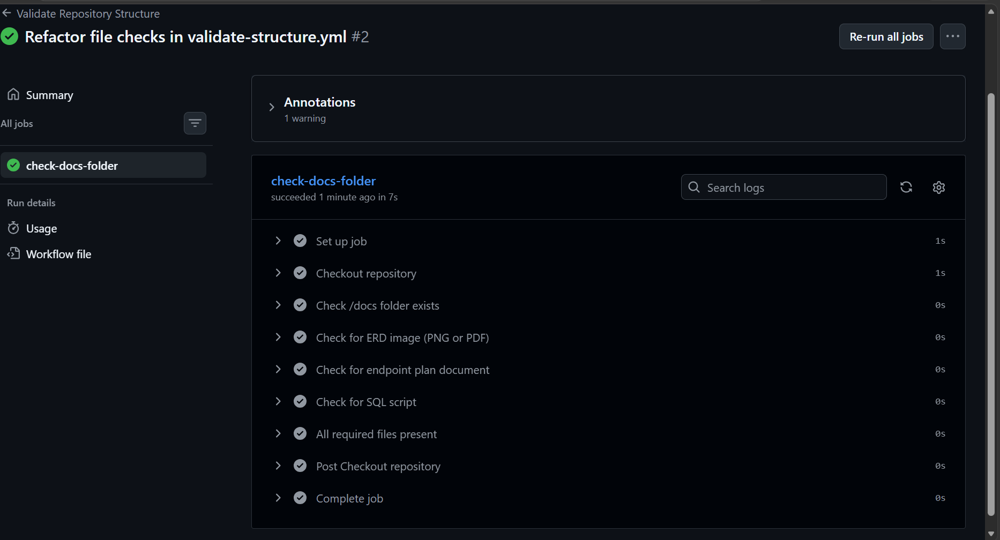
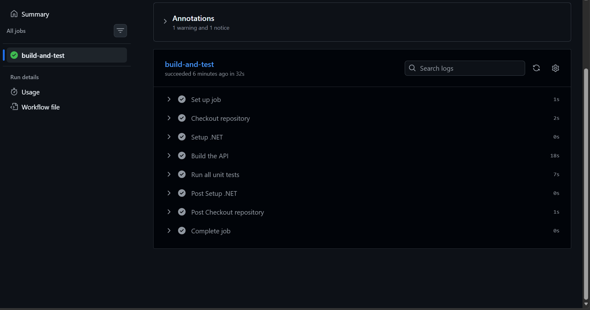
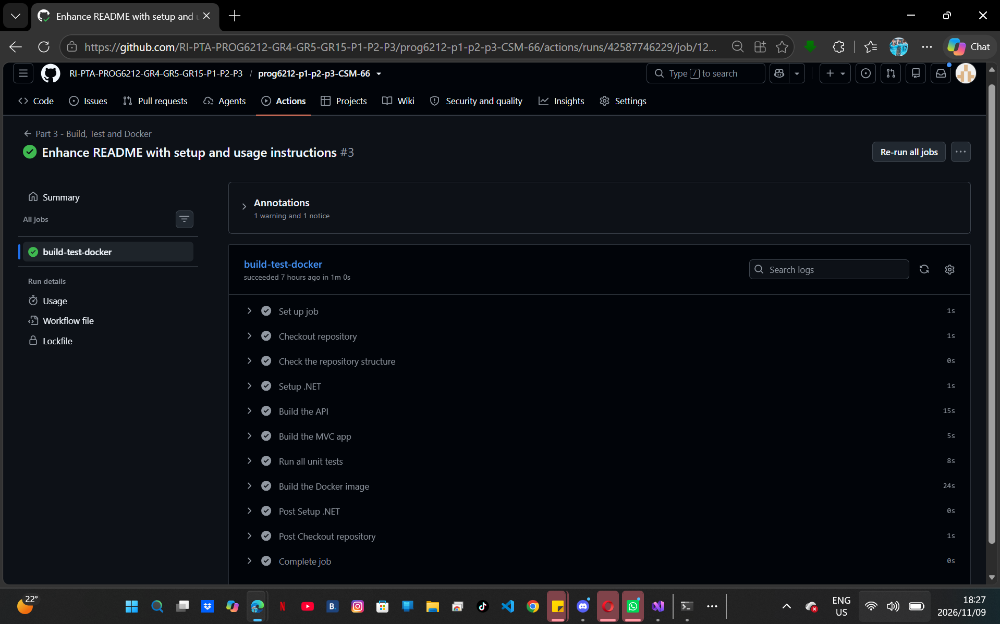

**Student:** Choeu Molepo
**Module:** PROG6212

# RaceDay

## System Description

RaceDay is a full-stack web-based event management system designed for the South African road running, walking, and cycling community. It replaces the paper-based registration, spreadsheets, and disconnected communication channels many community events currently rely on.The platform allows Event Organisers to create and manage events, categories, and
participant results, while Participants can browse upcoming events, enter
events by selecting a category, and track their personal performance history.

This repository contains **Part 1** of the project: system planning and
database design, including the Entity Relationship Diagram (ERD), the API
endpoint plan, and the SQL database script.

 ## Roles

**Event Organiser**
- Create, edit, and delete events
- Manage event categories
- Capture participant results
- View all enrolments for their events

**Participant**
- Create an account
- Browse upcoming events
- Enter an event by selecting a category
- View their own enrolments and track their personal results

## Technology Used

- SQL Server Management Studio (SSMS) - database design and scripting
- GitHub Actions - CI/CD workflow validation
- Markdown - documentation and endpoint planning

## Repository Structure
/docs
RaceDay_ERD.png - Entity Relationship Diagram
RaceDay_API_Endpoint_Plan (1).pdf - API endpoint plan
RaceDay_Schema.sql - Database creation script
RaceDay_SeedData.sql - Sample data seed script
cicd-success.png - CI/CD passing build screenshot
/.github/workflows
validate-structure.yml - CI/CD workflow validating /docs contents
README.md

## Design Notes

The `Events` table includes `Distance` and `EventType` fields, added after
cross-checking the Part 2 functional requirements, which specify that each
event must capture a distance and an event type (run, walk, or cycle). This
was a planned addition based on the brief's instruction to review all three
parts before finalising Part 1, not an unexplained deviation from the
original ERD.

Seed data was chosen to reflect realistic South African road events 
including a run, a cycle tour, and a marathon across three different
provinces, to demonstrate the schema working with varied real-world data.

Following lecturer feedback, the database design was revised so that Organisers and Participants are two separate entities, rather than a single Users table with a RoleID. This prevents a single account from holding both roles, and means Organiser accounts cannot be created through public self-registration — only Participant accounts can. Organiser accounts are provisioned separately (reflected in the seed data).

## CI/CD

A GitHub Actions workflow validates that the `/docs` folder exists and
contains the required files (ERD image, endpoint plan document, and SQL
script) on every push to `main`.



## Video Walkthrough

An unlisted YouTube video walking through the planning documents, ERD
decisions, endpoint plan choices, and a live run of the SQL script in SSMS
can be found here:
**[Watch the video]((https://youtu.be/rZQMX9Lrni4))**

## Next Steps

Part 2 will implement this planned API in C#, connect it to the RaceDayDB
database, and add unit tests with GitHub CI/CD.


## /////////////////////////////////////////////////////////////////////////////////////////////////////////////////////////////////////////////////////////////

# Part 2 - RESTful API

The RaceDay API is built with ASP.NET Core Web API in C#. It uses Entity Framework Core with the Code-First approach, session-based authentication, Swagger for documentation, and xUnit for unit tests. The code is in the `Part2` folder.

## The Two Roles

**Organiser**
- Creates, edits and deletes their own events
- Defines age or distance categories for their events
- Views all enrolments for their own events
- Captures finish times and positions for participants

**Participant**
- Browses events and categories
- Enters an event by selecting a category
- Views their own enrolments and results
- Views and updates their own profile

Both roles can view events and categories, and both can view and update their own profile. Organiser endpoints reject Participants and vice versa (403), and anything that needs a login rejects anonymous requests (401). An Organiser can also only change events they created.

## Authentication

- Users register with their details and choose a role (Organiser or Participant).
- Registering as an Organiser needs a secret organiser access code, so not just anyone can create Organiser accounts. The development code is `RaceDay-Organiser-2026` (set in `appsettings.json`).
- An email can only be used once across both roles, so one person can't hold both.
- Passwords are hashed with BCrypt and never stored in plain text.
- On login the server stores the user ID and role in the session, and every protected endpoint checks it.

## Database

The schema is created from the C# models with EF Core Code-First and matches the revised Part 1 design: `Organisers`, `Participants`, `Events`, `Categories`, `Enrolments` and `Results`. Organisers and Participants are separate tables, following lecturer feedback on Part 1.

## Setup and Run Instructions

**Requirements:** Visual Studio with the ASP.NET and web development workload, the .NET 10 SDK, and SQL Server (Express or LocalDB).

1. Clone the repository and open the solution file inside `Part2/RaceDayAPI` in Visual Studio.
2. Open `Part2/RaceDayAPI/appsettings.json` and change the server in `DefaultConnection` to your own SQL Server instance, for example `(localdb)\MSSQLLocalDB` or `.\SQLEXPRESS`.
3. Open **Tools > NuGet Package Manager > Package Manager Console** and run:
```
   Update-Database
```
   This creates the `RaceDayApiDB` database from the included migration.
4. Run the project (the green play button, **https** profile). The browser opens on Swagger at `https://localhost:7264/swagger`.
5. In Swagger, register users with `POST /api/auth/register`, log in with `POST /api/auth/login`, and then try the other endpoints. Swagger keeps the session cookie, so you stay logged in between requests.

## Endpoints

| Area | Endpoints |
|---|---|
| Auth | `POST /api/auth/register`, `POST /api/auth/login`, `POST /api/auth/logout` |
| Profile | `GET` and `PUT /api/participants/me`, `GET` and `PUT /api/organisers/me` |
| Events | `GET /api/events`, `GET /api/events/{id}`, `POST /api/events`, `PUT /api/events/{id}`, `DELETE /api/events/{id}` |
| Categories | `GET` and `POST /api/events/{eventId}/categories`, `PUT` and `DELETE /api/categories/{id}` |
| Enrolments | `POST /api/enrolments`, `GET /api/enrolments/me`, `GET /api/events/{eventId}/enrolments` |
| Results | `POST /api/results`, `GET /api/results/me` |

## Unit Tests

The `RaceDayAPI.Tests` project has 71 xUnit tests. They use an in-memory database and a fake session, so no SQL Server is needed. They cover registration and login, event management by Organisers, rejection of the wrong role on every protected endpoint, and enrolments being recorded correctly, with both success and failure cases.

To run them, use **Test > Run All Tests** in Visual Studio, or run this from the repository root:
```
dotnet test Part2/RaceDayAPI.Tests/RaceDayAPI.Tests.csproj
```

## CI/CD

The workflow `.github/workflows/part2-ci.yml` builds the API and runs all unit tests on every push to `main`.



## Video Walkthrough

An unlisted YouTube video demonstrating the running API, the code structure, the endpoints, authentication and the unit tests:

**[Watch the video](https://youtu.be/3psF5NeXD8Y)**


---

# Part 3 - Automation of the Web Application

Part 3 adds the web front end for RaceDay. An ASP.NET Core MVC application consumes the Part 2 API, Azure Blob Storage is integrated into the API for image uploads, and the MVC application runs in Docker. All of the Part 3 code is in the `Part3` folder:

| Folder | What it is |
|---|---|
| `Part3/RaceDayMvc` | The ASP.NET Core MVC web application and its `Dockerfile` |
| `Part3/RaceDayAPI` | The Part 2 API, extended for Part 3 (see "Changes to the API") |
| `Part3/RaceDayAPI.Tests` | xUnit tests for the API |

The `Part2` folder is untouched and still holds the Part 2 submission.

## The Two Roles

**Organiser** (menu: Dashboard, My Events, Enrolments, Results, Profile)
- **Dashboard:** events created, total enrolments, upcoming events, the next event, and enrolments per event
- **My Events:** create, edit and delete events (name, description, date, location, distance, type), with an event banner image upload
- **Categories:** add, edit and delete age or distance categories for each event
- **Enrolments:** see everyone who entered an event, with their category and status
- **Results:** capture finish times and positions for enrolled participants

**Participant** (menu: Events, My Enrolments, My Results, Profile)
- **Events:** upcoming events with search, type and location filters
- **Event details:** the banner, full details and categories, with **Enter event** to pick a category and enrol straight away
- **My Enrolments:** every event they entered, with a colour-coded status (green Confirmed, blue Completed)
- **My Results:** event, date, category, finish time and position, like "2nd out of 12"
- **Profile:** update name and email, and upload a profile picture

Visitors who aren't logged in can browse events and see event details, but need an account to enter.

## How It Works

**The MVC app only talks to the API.** It has no database access and no business logic. A single class, `ApiClient`, makes every call. Filtering, ownership checks, finisher totals and validation all happen in the API.

**Session-based authentication.** On login the MVC app calls the API, then stores the user's ID, name and role in its own session, together with the API's session cookie. `ApiClient` sends that cookie on every later call, so the API's role and ownership checks apply to each user. The MVC session cookie has its own name, so it doesn't clash with the API's cookie on `localhost`.
- A `RoleAuthorize` filter protects every page. Anonymous users are redirected to the login page, and users with the wrong role go to an access denied page.
- The menu is different for each role.
- Logging out clears both the MVC session and the API session.
- If the API reports that the session ended, the user is sent back to the login page.

**Azure Blob Storage, through the API only.** The MVC app sends the image file to the API. The API checks the size (5 MB), the type (JPG, PNG or WEBP) and the file header, uploads it to the `raceday-images` container, and saves the image URL in the database (`Events.BannerUrl` and `Participants.ProfilePictureUrl`). The MVC pages show the image from that URL. Only `BlobStorageService` in the API talks to Azure.

**Friendly errors.** Invalid input shows validation messages. If the API can't be reached, users see a message instead of a raw error.

**UI.** Bootstrap, with a sporting RaceDay theme (navy, orange and lime), the same layout and components on every page, and colour-coded enrolment statuses.

## Changes to the API

The `Part3/RaceDayAPI` copy adds what the front end needs:
- `GET /api/events` accepts `search`, `type` and `location` filters
- `GET /api/events/mine` returns the organiser's own events with enrolment totals
- Results include `totalFinishers` (finishers in the same category) and the event date
- Enrolments have the statuses `Confirmed` (when entered) and `Completed` (once a result is captured)
- Event banner upload: `POST /api/events/{id}/banner`
- Profile picture upload: `POST /api/participants/me/picture`
- The database gained `BannerUrl` and `ProfilePictureUrl` columns, added with a migration

## Setup and Run Instructions

**Requirements:** the .NET 10 SDK, SQL Server (Express or LocalDB), Docker Desktop, and an Azure storage account (only needed for image uploads).

**1. Clone the repository**
```
git clone <this repository's URL>
cd <the repository folder>
```

**2. Set up the API database**

Edit the `DefaultConnection` server in `Part3/RaceDayAPI/appsettings.json` to your own SQL Server instance, for example `(localdb)\MSSQLLocalDB`. Then create the database from the migrations:
```
dotnet tool install --global dotnet-ef
dotnet ef database update --project Part3/RaceDayAPI
```

**3. Set up Azure Blob Storage** (skip this to run without image uploads; everything else still works)

In the Azure portal, create a storage account, enable **Allow Blob anonymous access** on it, and create a container called `raceday-images` with the anonymous access level set to **Blob**. Then store the connection string as a user secret, which keeps it out of the repository:
```
dotnet user-secrets set "AzureBlob:ConnectionString" "<your connection string>" --project Part3/RaceDayAPI
```

**4. Run the API**
```
dotnet run --project Part3/RaceDayAPI --launch-profile https
```
The API listens on `https://localhost:7264` (with Swagger at `/swagger`) and on `http://0.0.0.0:5163`, which is the address the Docker container uses.

**5. Run the MVC app locally** (in a second terminal)
```
dotnet run --project Part3/RaceDayMvc
```
Open the address that the command prints. In Visual Studio you can also set **both** `RaceDayAPI` and `RaceDayMvc` as startup projects and press run.

**6. Create accounts**

Use the Register page. Participants register freely. Registering as an **Organiser** needs the access code, which in development is `RaceDay-Organiser-2026` (set in `Part3/RaceDayAPI/appsettings.json`).

## Docker

The MVC app has a multi-stage `Dockerfile` in `Part3/RaceDayMvc`. The first stage uses the .NET SDK image to restore and publish. The second stage copies only the published output into the smaller ASP.NET runtime image, and runs as a non-root user. The package restore is a separate step so Docker can cache it.

With the API running (step 4 above), build the image once and then start the container:
```
docker build -t raceday-mvc Part3/RaceDayMvc
docker run --rm -p 8080:8080 --name raceday-mvc raceday-mvc
```
Then open **http://localhost:8080**. The container behaves the same as the locally run app.

- The container reaches the API on the host through `http://host.docker.internal:5163/`. To point it somewhere else, add `-e Api__BaseUrl=<address of the API>/` to the `docker run` command.
- On Linux, add `--add-host=host.docker.internal:host-gateway` to the `docker run` command.
- Stop the container with `Ctrl+C`.
- The container never needs the Azure connection string, because only the API talks to Azure.

## Unit Tests

The API has 80 xUnit tests in `Part3/RaceDayAPI.Tests`, covering registration and login, role enforcement on every protected endpoint, events, categories, enrolments, results, profiles, filtering and the dashboard totals. They use an in-memory database, so no SQL Server is needed.
```
dotnet test Part3/RaceDayAPI.Tests/RaceDayAPI.Tests.csproj
```

## CI/CD

The workflow `.github/workflows/part3-ci.yml` runs on every push. It checks the repository structure, builds the API and the MVC app, runs all the unit tests, and builds the Docker image.



## Video Walkthrough

An unlisted YouTube video demonstrating the full running application, the MVC structure, the Blob Storage integration and the Docker setup:

**[Watch the video](YOUTUBE_LINK)**
