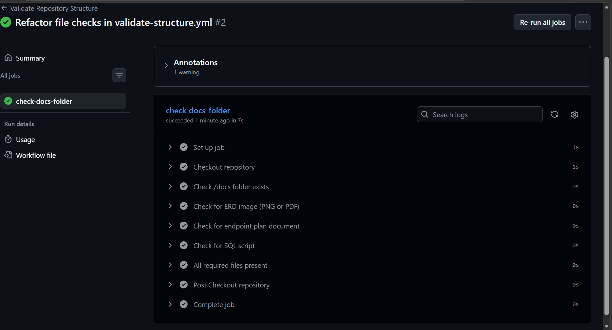
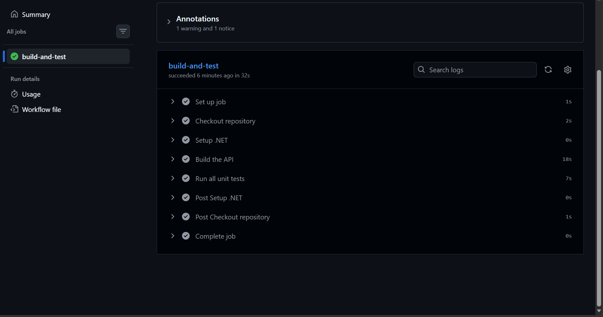

**Student:** Choeu Molepo
**Module:** PROG6212

# RaceDay

## System Description

RaceDay is a full-stack web-based event management system designed for the South African road running, walking, and cycling community. It replaces the paper-based registration, spreadsheets, and disconnected communication channels many community events currently rely on.The platform allows Event Organisers to create and manage events, categories, and
participant results, while Participants can browse upcoming events, enter
events by selecting a category, and track their personal performance history.

This repository contains **Part 1** of the project: system planning and
database design, including the Entity Relationship Diagram (ERD), the API
endpoint plan, and the SQL database script.

 ## Roles

**Event Organiser**
- Create, edit, and delete events
- Manage event categories
- Capture participant results
- View all enrolments for their events

**Participant**
- Create an account
- Browse upcoming events
- Enter an event by selecting a category
- View their own enrolments and track their personal results

## Technology Used

- SQL Server Management Studio (SSMS) - database design and scripting
- GitHub Actions - CI/CD workflow validation
- Markdown - documentation and endpoint planning

## Repository Structure
/docs
RaceDay_ERD.png - Entity Relationship Diagram
RaceDay_API_Endpoint_Plan (1).pdf - API endpoint plan
RaceDay_Schema.sql - Database creation script
RaceDay_SeedData.sql - Sample data seed script
cicd-success.png - CI/CD passing build screenshot
/.github/workflows
validate-structure.yml - CI/CD workflow validating /docs contents
README.md

## Design Notes

The `Events` table includes `Distance` and `EventType` fields, added after
cross-checking the Part 2 functional requirements, which specify that each
event must capture a distance and an event type (run, walk, or cycle). This
was a planned addition based on the brief's instruction to review all three
parts before finalising Part 1, not an unexplained deviation from the
original ERD.

Seed data was chosen to reflect realistic South African road events 
including a run, a cycle tour, and a marathon across three different
provinces, to demonstrate the schema working with varied real-world data.

Following lecturer feedback, the database design was revised so that Organisers and Participants are two separate entities, rather than a single Users table with a RoleID. This prevents a single account from holding both roles, and means Organiser accounts cannot be created through public self-registration — only Participant accounts can. Organiser accounts are provisioned separately (reflected in the seed data).

## CI/CD

A GitHub Actions workflow validates that the `/docs` folder exists and
contains the required files (ERD image, endpoint plan document, and SQL
script) on every push to `main`.



## Video Walkthrough

An unlisted YouTube video walking through the planning documents, ERD
decisions, endpoint plan choices, and a live run of the SQL script in SSMS
can be found here:
**[Watch the video]((https://youtu.be/rZQMX9Lrni4))**

## Next Steps

Part 2 will implement this planned API in C#, connect it to the RaceDayDB
database, and add unit tests with GitHub CI/CD.


## /////////////////////////////////////////////////////////////////////////////////////////////////////////////////////////////////////////////////////////////

# Part 2 - RESTful API

The RaceDay API is built with ASP.NET Core Web API in C#. It uses Entity Framework Core with the Code-First approach, session-based authentication, Swagger for documentation, and xUnit for unit tests. The code is in the `Part2` folder.

## The Two Roles

**Organiser**
- Creates, edits and deletes their own events
- Defines age or distance categories for their events
- Views all enrolments for their own events
- Captures finish times and positions for participants

**Participant**
- Browses events and categories
- Enters an event by selecting a category
- Views their own enrolments and results
- Views and updates their own profile

Both roles can view events and categories, and both can view and update their own profile. Organiser endpoints reject Participants and vice versa (403), and anything that needs a login rejects anonymous requests (401). An Organiser can also only change events they created.

## Authentication

- Users register with their details and choose a role (Organiser or Participant).
- Registering as an Organiser needs a secret organiser access code, so not just anyone can create Organiser accounts. The development code is `RaceDay-Organiser-2026` (set in `appsettings.json`).
- An email can only be used once across both roles, so one person can't hold both.
- Passwords are hashed with BCrypt and never stored in plain text.
- On login the server stores the user ID and role in the session, and every protected endpoint checks it.

## Database

The schema is created from the C# models with EF Core Code-First and matches the revised Part 1 design: `Organisers`, `Participants`, `Events`, `Categories`, `Enrolments` and `Results`. Organisers and Participants are separate tables, following lecturer feedback on Part 1.

## Setup and Run Instructions

**Requirements:** Visual Studio with the ASP.NET and web development workload, the .NET 10 SDK, and SQL Server (Express or LocalDB).

1. Clone the repository and open the solution file inside `Part2/RaceDayAPI` in Visual Studio.
2. Open `Part2/RaceDayAPI/appsettings.json` and change the server in `DefaultConnection` to your own SQL Server instance, for example `(localdb)\MSSQLLocalDB` or `.\SQLEXPRESS`.
3. Open **Tools > NuGet Package Manager > Package Manager Console** and run:
```
   Update-Database
```
   This creates the `RaceDayApiDB` database from the included migration.
4. Run the project (the green play button, **https** profile). The browser opens on Swagger at `https://localhost:7264/swagger`.
5. In Swagger, register users with `POST /api/auth/register`, log in with `POST /api/auth/login`, and then try the other endpoints. Swagger keeps the session cookie, so you stay logged in between requests.

## Endpoints

| Area | Endpoints |
|---|---|
| Auth | `POST /api/auth/register`, `POST /api/auth/login`, `POST /api/auth/logout` |
| Profile | `GET` and `PUT /api/participants/me`, `GET` and `PUT /api/organisers/me` |
| Events | `GET /api/events`, `GET /api/events/{id}`, `POST /api/events`, `PUT /api/events/{id}`, `DELETE /api/events/{id}` |
| Categories | `GET` and `POST /api/events/{eventId}/categories`, `PUT` and `DELETE /api/categories/{id}` |
| Enrolments | `POST /api/enrolments`, `GET /api/enrolments/me`, `GET /api/events/{eventId}/enrolments` |
| Results | `POST /api/results`, `GET /api/results/me` |

## Unit Tests

The `RaceDayAPI.Tests` project has 71 xUnit tests. They use an in-memory database and a fake session, so no SQL Server is needed. They cover registration and login, event management by Organisers, rejection of the wrong role on every protected endpoint, and enrolments being recorded correctly, with both success and failure cases.

To run them, use **Test > Run All Tests** in Visual Studio, or run this from the repository root:
```
dotnet test Part2/RaceDayAPI.Tests/RaceDayAPI.Tests.csproj
```

## CI/CD

The workflow `.github/workflows/part2-ci.yml` builds the API and runs all unit tests on every push to `main`.



## Video Walkthrough

An unlisted YouTube video demonstrating the running API, the code structure, the endpoints, authentication and the unit tests:

**[Watch the video](ytlink)**
